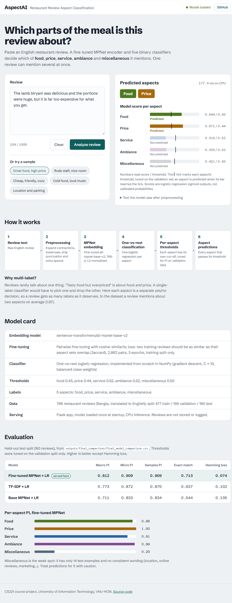
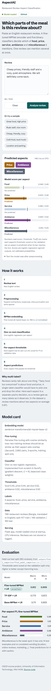
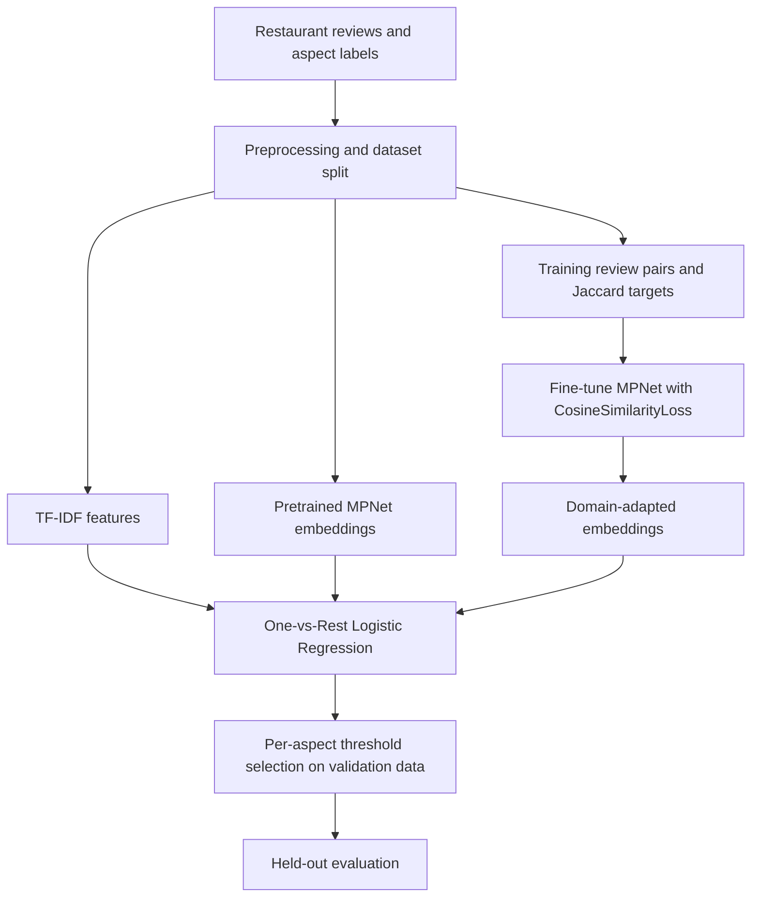

# AspectAI: Restaurant Review Aspect Classification

Given a restaurant review, predict which aspects it talks about: **food, price, service, ambiance, miscellaneous**.
One review can mention several aspects, so this is multi-label classification.

**Live demo:** not deployed yet (see [Deployment](#deployment)).

| Desktop | Mobile |
| --- | --- |
|  |  |

Final project for the NLP course (CS221) at the University of Information Technology, VNU-HCM.

## Model

| | |
| --- | --- |
| Encoder | `all-mpnet-base-v2`, fine-tuned with cosine-similarity loss on review pairs whose target similarity is the Jaccard overlap of their aspect sets (2,862 pairs, 3 epochs, train split only) |
| Classifier | One-vs-rest logistic regression written from scratch in NumPy ([manual_ovr_logistic_regression.py](manual_ovr_logistic_regression.py)), C = 10, balanced class weights, picked by validation grid search |
| Decision rule | Per-aspect thresholds tuned for F1 on the validation split (food 0.43, price 0.44, service 0.52, ambiance 0.52, miscellaneous 0.50). If no aspect passes, the top-scoring one is returned |
| Data | [Restaurant ABSA dataset](https://data.mendeley.com/datasets/998m4jy3m9/3): 796 Bangla reviews translated to English, split 477 / 159 / 160 (train / validation / test, seed 42) |

Two baselines were trained the same way: TF-IDF + logistic regression, and the base (not fine-tuned) MPNet + logistic regression.

### Inference pipeline

```
review -> clean text (expand contractions, lowercase, strip punctuation)
       -> fine-tuned MPNet embedding (768-d, L2-normalized)
       -> 5 logistic regressions -> per-aspect thresholds -> aspect labels
```

The demo shows each aspect's **model score**, which is the sigmoid output of the logistic regression. It is not a calibrated probability.

## Overview

Aspect classification is a subtask of Aspect-Based Sentiment Analysis (ABSA). Instead of predicting whether an entire review is positive or negative, this project identifies the topics discussed in a restaurant review. A single review can contain more than one aspect; sentiment polarity prediction is outside the scope of this project.

Example (illustrative):

```text
Input:  The food was delicious, but the service was slow.
Output: [food, service]
```

## Dataset

The [Restaurant ABSA dataset](https://data.mendeley.com/datasets/998m4jy3m9/3) contains 796 restaurant review sentences, originally in Bangla and translated into English for the experiments. The target space contains five aspects: `food`, `price`, `service`, `ambiance`, and `miscellaneous`.

The project analyzes label frequency, co-occurrence, text length and class imbalance before model development. The committed final comparison uses 160 test reviews according to the experiment documentation.


## Methodology



### Compared approaches

| Model | Representation | Classifier |
| --- | --- | --- |
| TF-IDF baseline | Sparse lexical features after text preprocessing | One-vs-Rest Logistic Regression |
| Pretrained MPNet | 768-dimensional `all-mpnet-base-v2` sentence embeddings | One-vs-Rest Logistic Regression |
| Fine-tuned MPNet | Domain-adapted sentence embeddings | One-vs-Rest Logistic Regression |

The historical encoder training documentation describes 2,880 training review pairs (the current model uses 2,862, as recorded above) with Jaccard similarity between their aspect-label sets as a continuous supervision signal. `CosineSimilarityLoss` aligns embedding similarity with this target. Classifier hyperparameters and per-aspect decision thresholds are selected using validation data. See [training details](docs/SBERT-training.md) for the complete procedure.

## Results

Held-out test split, 160 reviews. Source: [outputs/final_comparison/final_model_comparison.csv](outputs/final_comparison/final_model_comparison.csv), produced by [notebooks/final_comparison.ipynb](notebooks/final_comparison.ipynb).

| Model | Macro F1 | Micro F1 | Samples F1 | Exact match | Hamming loss |
| --- | ---: | ---: | ---: | ---: | ---: |
| **Fine-tuned MPNet + LR** (served in the demo) | **0.812** | **0.909** | **0.909** | **0.713** | **0.074** |
| TF-IDF + LR | 0.773 | 0.872 | 0.870 | 0.637 | 0.102 |
| Base MPNet + LR | 0.711 | 0.833 | 0.834 | 0.544 | 0.135 |

Per-aspect F1 for the fine-tuned model: food 0.96, price 1.00, service 0.91, ambiance 0.99, miscellaneous 0.20.
`demo/tests` checks that the served pipeline reproduces the first row exactly.

The results table in earlier versions of this README and the numbers in [docs/comparison.md](docs/comparison.md) come from earlier training runs. They do not match the committed models, so they are not used here.

### Error analysis

| Aspect | Fine-tuned MPNet | TF-IDF | Pretrained MPNet |
| --- | ---: | ---: | ---: |
| Food | **0.9640** | 0.9116 | 0.9258 |
| Price | **1.0000** | 0.9186 | 0.9371 |
| Service | **0.9136** | 0.8293 | 0.7059 |
| Ambiance | **0.9855** | 0.7632 | 0.6944 |
| Miscellaneous | 0.1961 | **0.4444** | 0.2917 |

The broad `miscellaneous` category remains difficult; in the committed comparison, fine-tuned MPNet is weaker than TF-IDF on this label despite stronger aggregate performance. Improving label definitions, class balance and threshold calibration are natural next steps.

## Run locally

Requires Python 3.13 and [Git LFS](https://git-lfs.com) (the model weights are stored with LFS).

```bash
git lfs install && git lfs pull          # downloads models/ (~420 MB for the served encoder)
python -m venv .venv
source .venv/bin/activate                # Windows: .venv\Scripts\activate
pip install --index-url https://download.pytorch.org/whl/cpu torch==2.12.1
pip install -r demo/requirements.txt
python -m nltk.downloader stopwords wordnet omw-1.4
python demo/app.py                       # http://127.0.0.1:5000
```

Tests (about 2 minutes, mostly model loading and the test-set check):

```bash
pip install pytest
python -m pytest demo/tests
```

**Model artifacts the demo needs:**
- `models/mpnet/retrained_encoder/`
- `models/mpnet/classifiers/retrained/model.joblib`
- `models/mpnet/classifiers/retrained/metadata.json`
- `manual_ovr_logistic_regression.py`, which must be importable because the classifier is pickled.

The encoder was saved with sentence-transformers 5.6.0 and cannot be loaded by older versions (5.0 fails), so keep the pins in [demo/requirements.txt](demo/requirements.txt).

**Configuration** (environment variables, all optional): `PORT`, `MODEL_DIR` (default `models/mpnet`), `CLASSIFIER_NAME` (default `retrained`), `RATE_LIMIT_PER_MINUTE` (default 30).

**Endpoints:** `GET /` (UI), `POST /analyze` with `{"text": "..."}`, `GET /healthz` (200 once the model is loaded, 503 otherwise).

## Deployment

Target: **Hugging Face Spaces, Docker SDK, free CPU tier** (2 vCPU, 16 GB RAM). The app needs roughly 1.5 GB of RAM for torch plus the 420 MB encoder. That rules out 512 MB free tiers such as Render's, while Spaces gives a public URL with no server to manage.

1. Create a Space at huggingface.co/new-space with SDK **Docker** and template **Blank**.
2. Upload only what the image needs. The YAML header at the top of this README is the Space config.
   ```bash
   pip install -U huggingface_hub && hf auth login
   hf upload <user>/<space> . . --repo-type space --include \
     README.md Dockerfile preprocessing.py manual_ovr_logistic_regression.py \
     "demo/app.py" "demo/inference.py" "demo/requirements.txt" "demo/templates/*" "demo/static/*" \
     "models/mpnet/retrained_encoder/*" "models/mpnet/classifiers/retrained/*" \
     "outputs/final_comparison/final_model_comparison.csv"
   ```
   (A plain `git push` to the Space is rejected, because this repo has binary files that are not in LFS.)
3. The Space builds the [Dockerfile](Dockerfile) and serves on port 7860. Check `https://<user>-<space>.hf.space/healthz`.

To run the same image locally: `docker build -t aspectai . && docker run -p 7860:7860 aspectai`.

Public-use safeguards: request body capped at 16 KB, reviews capped at 1,000 characters, 30 requests per minute per client, generic error messages, no review text stored or logged, and no external API calls (the model runs offline inside the container).

## Limitations

- **Preprocessing mismatch in the original pipeline.** The classifier was fit on embeddings of `review_cleaned`, the text with stopwords removed and words lemmatized. The evaluation notebooks, and therefore the published metrics, feed it `review_en` (cleaned only). The demo serves the evaluated setup so that the numbers above describe what it runs. With the training-time preprocessing at test time the scores are lower: macro F1 0.775, micro F1 0.875, Hamming loss 0.101 (reproduced locally; not a committed artifact). The proper fix is to refit the classifier and thresholds on `review_en` embeddings and re-evaluate.
- **Small data.** The test split has 160 reviews, and `miscellaneous` has only 14 test positives (F1 0.20). On new text the model tends to over-predict it.
- **Compressed scores.** Scores mostly fall between 0.3 and 0.7, and thresholds sit close to 0.5, so small wording changes can flip a decision.
- **English only.** The training data is machine-translated, so phrasing that differs from the translations can be misread.
- **Latency.** About 100–200 ms per review on a laptop CPU.
- **Rate limit.** It is in-process and keyed on `X-Forwarded-For`, so it is a soft guard against floods, not abuse protection.
- **Hosting.** Free Spaces sleep when idle; the first visit after that waits for a cold start.

## Future improvements

- Refit the classifier on the same text form it is evaluated on (see the first limitation).
- Calibrate the scores (Platt or isotonic) so they can be read as probabilities.
- Write labelling guidelines for `miscellaneous`, or merge or split it, then relabel.
- Add aspect-level sentiment; the dataset includes polarity labels.
- Export the encoder to ONNX and quantize it for faster CPU inference.

## Reproduce the experiments

```bash
git clone https://github.com/zaabinh/3bit-CS221.git
cd 3bit-CS221
git checkout master
python -m venv .venv
source .venv/bin/activate  # Windows: .venv\Scripts\activate
pip install -r requirements.txt
```

Obtain the dataset from the linked source, configure the input paths in the notebooks and run the relevant stages. If model weights are stored through Git LFS, retrieve them before inference.

| Stage | Notebook |
| --- | --- |
| Data preparation | [Preprocessing](notebooks/01-preprocessing.ipynb) · [Labeling](notebooks/02-labelling.ipynb) · [EDA](notebooks/03-EDA.ipynb) |
| TF-IDF | [Vectorization](notebooks/TF-IDF/01-tfidf_Vectorization.ipynb) · [Training](notebooks/TF-IDF/02-tfidf_ovr_logistic_regression.ipynb) · [Evaluation](notebooks/TF-IDF/03-tfidf_evaluate.ipynb) |
| MPNet | [Encoder fine-tuning](notebooks/SentenceTransformer/01-mpnet_retraining.ipynb) · [Classifier training](notebooks/SentenceTransformer/02-mpnet_ovr_logistic_regression.ipynb) · [Evaluation](notebooks/SentenceTransformer/03-mpnet_evaluate.ipynb) |
| Model comparison | [Final comparison](notebooks/final_comparison.ipynb) |

## Further reading

- [Dataset analysis](docs/EDA-summarization.md)
- [Sentence Transformer training methodology](docs/SBERT-training.md)
- [Historical comparison and error analysis](docs/comparison.md)
- [Committed numeric results](outputs/final_comparison/final_model_comparison.csv)

## Repository layout

```
demo/            Flask app (app.py), inference (inference.py), UI, tests
models/          MPNet encoders + classifiers, TF-IDF model (Git LFS)
notebooks/       preprocessing, EDA, TF-IDF and MPNet training/evaluation, final comparison
outputs/         evaluation CSVs and figures
preprocessing.py inference-time copy of the notebook text cleaning
```

## Team

Đoàn Hữu Gia Bình (24520192), Nguyễn Quang Đông (24520310), Nguyễn Thị Ái Trâm (24521805).
Supervisor: Dr. Nguyễn Trọng Chỉnh.
