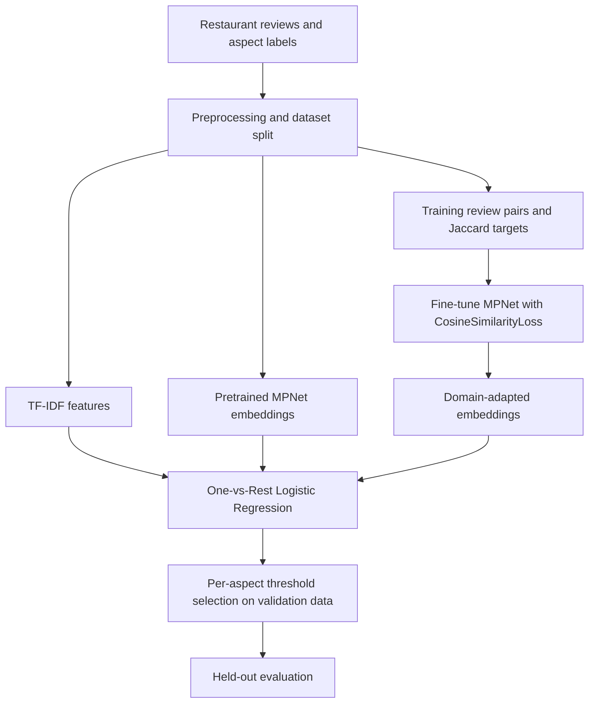

# Multi-Label Aspect Classification for Restaurant Reviews

An NLP benchmark comparing sparse lexical features and domain-adapted sentence embeddings for identifying multiple aspects in customer reviews.

**Best result in the committed comparison CSV:** 81.18% Macro F1 · 90.91% Micro F1 (fine-tuned MPNet)

**Stack:** Python · Sentence Transformers · MPNet · scikit-learn · PyTorch · Flask · Jupyter

## Overview

Aspect classification is a subtask of Aspect-Based Sentiment Analysis (ABSA). Instead of predicting whether an entire review is positive or negative, this project identifies the topics discussed in a restaurant review. A single review can contain more than one aspect; sentiment polarity prediction is outside the scope of this project.

Example (illustrative):

```text
Input:  The food was delicious, but the service was slow.
Output: [food, service]
```

## Dataset

The [Restaurant ABSA dataset](https://data.mendeley.com/datasets/998m4jy3m9/3) contains 796 restaurant review sentences, originally in Bangla and translated into English for the experiments. The target space contains five aspects: `food`, `price`, `service`, `ambiance`, and `miscellaneous`.

The project analyzes label frequency, co-occurrence, text length and class imbalance before model development. The committed final comparison uses 160 test reviews according to the experiment documentation.


## Methodology



### Compared approaches

| Model | Representation | Classifier |
| --- | --- | --- |
| TF-IDF baseline | Sparse lexical features after text preprocessing | One-vs-Rest Logistic Regression |
| Pretrained MPNet | 768-dimensional `all-mpnet-base-v2` sentence embeddings | One-vs-Rest Logistic Regression |
| Fine-tuned MPNet | Domain-adapted sentence embeddings | One-vs-Rest Logistic Regression |

The encoder training documentation describes 2,880 training review pairs with Jaccard similarity between their aspect-label sets as a continuous supervision signal. `CosineSimilarityLoss` aligns embedding similarity with this target. Classifier hyperparameters and per-aspect decision thresholds are selected using validation data. See [training details](docs/SBERT-training.md) for the complete procedure.

## Experimental results

The table below is taken from the repository's committed [final comparison CSV](outputs/final_comparison/final_model_comparison.csv), rounded consistently. Higher is better except Hamming loss and latency.

| Model | Macro F1 | Micro F1 | Samples F1 | Exact match | Hamming loss | ms/review |
| --- | ---: | ---: | ---: | ---: | ---: | ---: | ---: |
| **Fine-tuned MPNet** | **0.8118** | **0.9091** | **0.9092** | **0.7125** | **0.07375** | 30.82 |
| TF-IDF | 0.7734 | 0.8723 | 0.8704 | 0.6375 | 0.10250 | **0.02077** |
| Pretrained MPNet | 0.7110 | 0.8328 | 0.8344 | 0.5438 | 0.13500 | 20.29 |

Fine-tuning improved Macro F1 by 10.09 percentage points and Micro F1 by 7.63 points relative to the pretrained MPNet baseline in this recorded comparison. TF-IDF remains attractive when latency and computational simplicity are the primary requirements.

### Error analysis

| Aspect | Fine-tuned MPNet | TF-IDF | Pretrained MPNet |
| --- | ---: | ---: | ---: |
| Food | **0.9640** | 0.9116 | 0.9258 |
| Price | **1.0000** | 0.9186 | 0.9371 |
| Service | **0.9136** | 0.8293 | 0.7059 |
| Ambiance | **0.9855** | 0.7632 | 0.6944 |
| Miscellaneous | 0.1961 | **0.4444** | 0.2917 |

The broad `miscellaneous` category remains difficult; in the committed comparison, fine-tuned MPNet is weaker than TF-IDF on this label despite stronger aggregate performance. Improving label definitions, class balance and threshold calibration are natural next steps.

> **Reproducibility note:** The historical [comparison report](docs/comparison.md), [training report](docs/SBERT-training.md) and previously reported README results contain different metric snapshots. This README uses the committed CSV as its explicit numeric source rather than combining runs. Re-execute the final comparison notebook and reconcile the dataset split, model artifacts and thresholds before treating any snapshot as the definitive benchmark. Latency is also specific to the recorded runtime.

## Reproduce the experiments

```bash
git clone https://github.com/zaabinh/3bit-CS221.git
cd 3bit-CS221
git checkout master
python -m venv .venv
source .venv/bin/activate  # Windows: .venv\Scripts\activate
pip install -r requirements.txt
```

Obtain the dataset from the linked source, configure the input paths in the notebooks and run the relevant stages. If model weights are stored through Git LFS, retrieve them before inference.

| Stage | Notebook |
| --- | --- |
| Data preparation | [Preprocessing](notebooks/01-preprocessing.ipynb) · [Labeling](notebooks/02-labelling.ipynb) · [EDA](notebooks/03-EDA.ipynb) |
| TF-IDF | [Vectorization](notebooks/TF-IDF/01-tfidf_Vectorization.ipynb) · [Training](notebooks/TF-IDF/02-tfidf_ovr_logistic_regression.ipynb) · [Evaluation](notebooks/TF-IDF/03-tfidf_evaluate.ipynb) |
| MPNet | [Encoder fine-tuning](notebooks/SentenceTransformer/01-mpnet_retraining.ipynb) · [Classifier training](notebooks/SentenceTransformer/02-mpnet_ovr_logistic_regression.ipynb) · [Evaluation](notebooks/SentenceTransformer/03-mpnet_evaluate.ipynb) |
| Model comparison | [Final comparison](notebooks/final_comparison.ipynb) |

## Interactive demo

The repository includes a Flask application with a review input page and a `POST /analyze` endpoint. It loads the fine-tuned encoder and its trained classifier from `demo/models/mpnet/`, whereas the tracked artifacts reside under the root `models/mpnet/` directory. Make these artifacts available at the path expected by the demo (or update its local configuration) before running it.

```bash
pip install -r demo/requirements.txt
python demo/app.py
```

Open http://127.0.0.1:5000 for local experimentation. The demo runs in Flask debug mode and is not configured as a production inference service.

## Repository layout

```text
notebooks/    Preprocessing, EDA, training and evaluation
models/       Saved encoders, vectorizer and classifiers
outputs/      Experiment tables, figures and predictions
demo/         Flask inference demonstration
docs/         Technical reports and training notes
```

## Further reading

- [Dataset analysis](docs/EDA-summarization.md)
- [Sentence Transformer training methodology](docs/SBERT-training.md)
- [Historical comparison and error analysis](docs/comparison.md)
- [Committed numeric results](outputs/final_comparison/final_model_comparison.csv)

## Contributors

Academic team project — CS221 Natural Language Processing, University of Information Technology (VNU-HCM).

- Đoàn Hữu Gia Bình
- Nguyễn Quang Đông
- Nguyễn Thị Ái Trâm

Supervisor: Nguyễn Trọng Chỉnh.
